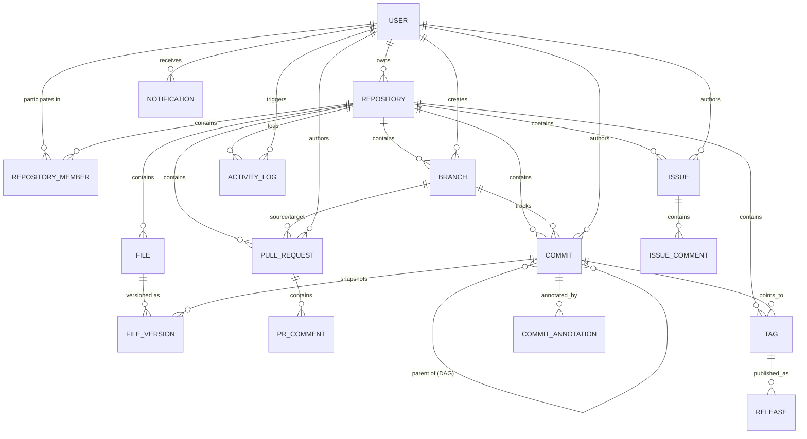

# MÍMIR VCS — Comprehensive DBMS Project Report & Technical Master Guide

> **Academic Course:** Database Management Systems (DBMS) — Semester 5  
> **Project Name:** Mímir — A Distributed, MongoDB-Native Version Control System  
> **Repository:** `C:\Users\anees\Desktop\Sem 5\DBMS\Project\Mimir`  
> **Tech Stack:** Node.js, Express.js, MongoDB (Mongoose ODM), React 19, Vite, Tailwind CSS, SHA-256 Cryptography  
> **Author:** Project Team / Aneesh  

---

## Table of Contents

1. [Executive Summary & System Vision](#1-executive-summary--system-vision)
2. [DBMS Theoretical Foundations & Concept Mapping](#2-dbms-theoretical-foundations--concept-mapping)
3. [System Architecture & C4 Model](#3-system-architecture--c4-model)
4. [Entity-Relationship (ER) Design & All 17 Collections](#4-entity-relationship-er-design--all-17-collections)
5. [How Everything Is Connected: End-to-End System Integration](#5-how-everything-is-connected-end-to-end-system-integration)
6. [Comprehensive Code File-by-File Breakdown](#6-comprehensive-code-file-by-file-breakdown)
   - [6.1 Backend Core & Bootstrapping](#61-backend-core--bootstrapping)
   - [6.2 Backend Utilities & Cryptographic Algorithms](#62-backend-utilities--cryptographic-algorithms)
   - [6.3 Backend Core VCS Services (Business Logic)](#63-backend-core-vcs-services-business-logic)
   - [6.4 Backend Controllers (API Handlers)](#64-backend-controllers-api-handlers)
   - [6.5 Backend Middleware & Access Control](#65-backend-middleware--access-control)
   - [6.6 Backend Routes](#66-backend-routes)
   - [6.7 Frontend Architecture, State, & Views](#67-frontend-architecture-state--views)
7. [Database Triggers in Depth: Theory, MongoDB Patterns, & Code](#7-database-triggers-in-depth-theory-mongodb-patterns--code)
8. [Multi-Document ACID Transactions & Concurrency Control](#8-multi-document-acid-transactions--concurrency-control)
9. [The Commit Engine: Merkle Trees & Directed Acyclic Graphs (DAG)](#9-the-commit-engine-merkle-trees--directed-acyclic-graphs-dag)
10. [MongoDB Aggregation Pipelines: Analytical Query Engine](#10-mongodb-aggregation-pipelines-analytical-query-engine)
11. [Indexing Strategy & Query Optimization](#11-indexing-strategy--query-optimization)
12. [Mímir vs. Traditional Git / GitHub](#12-mimir-vs-traditional-git--github)
13. [DBMS Viva Defense Guide & Live Demonstrations](#13-dbms-viva-defense-guide--live-demonstrations)

---

## 1. Executive Summary & System Vision

### 1.1 What is Mímir?
**Mímir** (named after the Norse god of wisdom and memory) is a full-stack, distributed Version Control System (VCS) designed from the ground up to run natively on a **document-oriented Database Management System (MongoDB)**. 

Traditional version control engines (such as Git) rely on the host operating system's filesystem, persisting revisions as raw, loose binary objects and packed diff files in a hidden directory (`.git/objects/pack`). External web interfaces like GitHub or GitLab must superimpose an auxiliary relational database (e.g., MySQL or PostgreSQL) to index user metadata, issue trackers, and pull requests, creating an architectural disconnect between VCS history and database queryability.

**Mímir eliminates this dichotomy.** By modeling repositories, branches, commits, file snapshots, pull requests, and audit logs directly as first-class, structured documents in MongoDB:
- The commit history forms a native **Directed Acyclic Graph (DAG)** stored using MongoDB document references (`parentCommits: [ObjectId]`).
- Every commit represents an immutable cryptographic snapshot governed by a **SHA-256 Merkle Tree**.
- Atomic operations across multiple entities (commits, file versions, branch head pointers, and activity logs) are executed using **Multi-Document ACID Transactions**.
- Complex versioning queries (such as cross-branch file evolution, hotspot merge conflicts, and contributor code ownership) execute directly inside the database engine via the **MongoDB Aggregation Pipeline**.

---

## 2. DBMS Theoretical Foundations & Concept Mapping

In academic evaluation, Mímir bridges standard DBMS theory with modern distributed systems engineering:

| Version Control Primitive | DBMS / Distributed Systems Primitive | Mímir Technical Implementation |
|---|---|---|
| **Commit Creation** | Multi-Document ACID Transaction | `runInTransaction()` in [`transactionHelper.js`](file:///backend/utils/transactionHelper.js) across `Commit`, `FileVersion`, `File`, and `Branch` |
| **Commit Graph** | Directed Acyclic Graph (DAG) | Adjacency list array `parentCommits: [ObjectId]` stored natively within each `Commit` document |
| **Commit Integrity** | Cryptographic Hashing & Merkle Trees | Bottom-up binary hash tree pairing SHA-256 hashes of file contents in [`merkle.js`](file:///backend/utils/merkle.js) |
| **Lost Update Anomaly** | Optimistic Concurrency Control (OCC) | Conditional atomic write: `Branch.updateOne({ _id: branchId, headCommit: expectedParentCommitId })` |
| **Audit Trail** | Write-Once-Read-Many (WORM) Auditing | Immutable append-only `ActivityLog` collection with compound B-tree index `{ repository: 1, action: 1, createdAt: -1 }` |
| **Version Recovery** | Non-Destructive Inverse Delta Snapshot | Forward-moving Git Revert computing inverse deltas against the parent commit in [`recoveryService.js`](file:///backend/services/recoveryService.js) |
| **Branch Protection** | Role-Based Access Control (RBAC) & Invariant Checking | Middleware gatekeeper checking `RepositoryMember.role` and logging violations prior to commit execution |
| **Merge Base Resolution** | Graph LCA (Lowest Common Ancestor) | Breadth-First Search (BFS) graph traversal across parent commit edges in [`mergeService.js`](file:///backend/services/mergeService.js) |
| **Merge Conflicts** | 3-Way Differential Text Analysis | Line-level diff comparing Base, Target, and Source snapshots with automated Git conflict marker insertion |
| **Database Triggers** | Event-Condition-Action (ECA) Model | Mongoose lifecycle pre/post hooks, transactional hooks, cascading version updates, and compensating rollback triggers |

---

## 3. System Architecture & C4 Model

Mímir is structured according to the **C4 architectural model** (Context, Containers, Components, and Code).

```
┌────────────────────────────────────────────────────────────────────────┐
│                              C4 CONTEXT                                │
│                                                                        │
│   [Developer / User]                                                   │
│           │                                                            │
│           │ Interacts via Web Browser (HTTPS)                          │
│           ▼                                                            │
│   [Mímir VCS Platform] ◄───► [MongoDB Database Cluster (Replica Set)]  │
└────────────────────────────────────────────────────────────────────────┘
```

### 3.1 C4 — Container Level
The platform consists of three distinct runtime tiers:

```
┌──────────────────────────────────────────────────────────────────────────┐
│                           CONTAINER DIAGRAM                              │
│                                                                          │
│  ┌────────────────────────────────────────────────────────────────────┐  │
│  │ Single Page Application (SPA)                                      │  │
│  │ React 19, Vite, Tailwind CSS, Lucide Icons, HTML5 Canvas           │  │
│  │ Port: 5173                                                         │  │
│  └─────────────────────────────────┬──────────────────────────────────┘  │
│                                    │                                     │
│                                    │ REST API JSON Calls (Axios)         │
│                                    │ Base URL: http://localhost:5000/api │
│                                    ▼                                     │
│  ┌────────────────────────────────────────────────────────────────────┐  │
│  │ REST API Backend Service                                           │  │
│  │ Node.js, Express.js, JWT, Mongoose ODM                             │  │
│  │ Port: 5000                                                         │  │
│  └─────────────────────────────────┬──────────────────────────────────┘  │
│                                    │                                     │
│                                    │ MongoDB Wire Protocol               │
│                                    │ mongodb://localhost:27017/mimir     │
│                                    ▼                                     │
│  ┌────────────────────────────────────────────────────────────────────┐  │
│  │ Database Tier (MongoDB 7.0+ Replica Set / Atlas)                   │  │
│  │ 17 Collections, B-Tree Compound Indexes, Full-Text Indexes         │  │
│  └────────────────────────────────────────────────────────────────────┘  │
└──────────────────────────────────────────────────────────────────────────┘
```

### 3.2 C4 — Component Diagram (Backend API)
Inside the Express API container, components are separated according to the **Layered Architecture Pattern**:

```
Routes (HTTP endpoints)
    │
    ▼
Middleware (Auth JWT verification, Repo resolution, RBAC permissions)
    │
    ▼
Controllers (Input validation, HTTP status mapping, response serialization)
    │
    ▼
Services (Heavy business logic, Merkle computation, 3-way merge, ACID transactions)
    │
    ▼
Models (Mongoose Schemas, validation rules, lifecycle hooks) ──► MongoDB Driver
```

---

## 4. Entity-Relationship (ER) Design & All 17 Collections

Mímir uses **17 Mongoose models**, mapping to 17 distinct collections in MongoDB. The design follows the core NoSQL maxim: **Embed for atomic locality, reference for unbounded or shared graph data.**



### Detailed Collection Breakdown

#### 1. `users` ([`User.js`](file:///backend/models/User.js))
- **Role:** Authentication, identity, and profile storage.
- **Fields:** `username` (String, unique), `email` (String, unique), `passwordHash` (String, select: false), `avatar` (String), `bio` (String), `role` (enum: `'user'`, `'admin'`), `accountStatus` (enum: `'active'`, `'suspended'`, `'deleted'`), `lastLogin` (Date).
- **Indexes:** `{ username: 1 }` (unique), `{ email: 1 }` (unique), `{ username: 'text', bio: 'text' }` (text search).
- **Triggers / Hooks:** `pre('save')` automated bcrypt hash trigger.

#### 2. `repositories` ([`Repository.js`](file:///backend/models/Repository.js))
- **Role:** Root organizational unit for source code.
- **Fields:** `owner` (ObjectId → User), `name` (String), `description` (String), `visibility` (enum: `'public'`, `'private'`), `defaultBranch` (String, default: `'main'`), `isArchived` (Boolean), `stars` (Number), `forks` (Number).
- **Indexes:** `{ owner: 1, name: 1 }` (unique compound index enforcing slug uniqueness per user).

#### 3. `repositorymembers` ([`RepositoryMember.js`](file:///backend/models/RepositoryMember.js))
- **Role:** Granular Role-Based Access Control (RBAC) mapping.
- **Fields:** `repository` (ObjectId → Repository), `user` (ObjectId → User), `role` (enum: `'owner'`, `'maintainer'`, `'developer'`, `'viewer'`).
- **Indexes:** `{ repository: 1, user: 1 }` (unique compound index preventing duplicate memberships).

#### 4. `branches` ([`Branch.js`](file:///backend/models/Branch.js))
- **Role:** Lightweight mutable pointers to commit graph tips (HEAD).
- **Fields:** `repository` (ObjectId → Repository), `name` (String), `headCommit` (ObjectId → Commit), `isProtected` (Boolean), `isDefault` (Boolean), `creator` (ObjectId → User).
- **Indexes:** `{ repository: 1, name: 1 }` (unique compound index enforcing unique branch names per repo).

#### 5. `commits` ([`Commit.js`](file:///backend/models/Commit.js))
- **Role:** The core immutable snapshot node in the Directed Acyclic Graph.
- **Fields:** `repository` (ObjectId → Repository), `branch` (ObjectId → Branch), `parentCommits` (`[ObjectId → Commit]`), `author` (ObjectId → User), `message` (String), `sha` (String, 64-char SHA-256), `merkleRoot` (String, 64-char SHA-256), `isMergeCommit` (Boolean), `filesChanged` (Number), `tree` (`[{ path: String, fileVersion: ObjectId → FileVersion }]`).
- **Indexes:** `{ sha: 1 }` (unique), `{ repository: 1, branch: 1, createdAt: -1 }` (compound for fast timeline queries), `{ message: 'text' }` (text search).

#### 6. `files` ([`File.js`](file:///backend/models/File.js))
- **Role:** Persistent logical file identity across historical versions.
- **Fields:** `repository` (ObjectId → Repository), `path` (String), `latestVersion` (ObjectId → FileVersion), `isDeleted` (Boolean).
- **Indexes:** `{ repository: 1, path: 1 }` (unique compound index).

#### 7. `fileversions` ([`FileVersion.js`](file:///backend/models/FileVersion.js))
- **Role:** Actual content payload snapshot for a file at a specific commit.
- **Fields:** `repository` (ObjectId → Repository), `file` (ObjectId → File), `filePath` (String), `content` (String), `contentHash` (String, SHA-256 of content), `commit` (ObjectId → Commit), `versionNumber` (Number), `fileSize` (Number in bytes).
- **Indexes:** `{ file: 1, versionNumber: -1 }`, `{ repository: 1, filePath: 1, createdAt: -1 }` (compound index enabling global cross-branch file evolution queries).

#### 8. `pullrequests` ([`PullRequest.js`](file:///backend/models/PullRequest.js))
- **Role:** Proposed branch merges with code review lifecycle.
- **Fields:** `repository` (ObjectId → Repository), `number` (Number), `title` (String), `description` (String), `sourceBranch` (ObjectId → Branch), `targetBranch` (ObjectId → Branch), `author` (ObjectId → User), `status` (enum: `'open'`, `'merged'`, `'closed'`), `mergeCommit` (ObjectId → Commit), `reviewers` (`[ObjectId → User]`), `labels` (`[ObjectId → Label]`), `mergedAt` (Date), `closedAt` (Date).
- **Indexes:** `{ repository: 1, number: 1 }` (unique compound index), `{ repository: 1, status: 1 }`.

#### 9. `prcomments` ([`PRComment.js`](file:///backend/models/PRComment.js))
- **Role:** Threaded discussions and review feedback on pull requests.
- **Fields:** `pullRequest` (ObjectId → PullRequest), `author` (ObjectId → User), `body` (String), `filePath` (String, optional for line notes), `lineNumber` (Number, optional).

#### 10. `issues` ([`Issue.js`](file:///backend/models/Issue.js))
- **Role:** Task, bug, and issue tracking.
- **Fields:** `repository` (ObjectId → Repository), `number` (Number), `title` (String), `body` (String), `author` (ObjectId → User), `assignees` (`[ObjectId → User]`), `labels` (`[ObjectId → Label]`), `status` (enum: `'open'`, `'closed'`), `closedAt` (Date).
- **Indexes:** `{ repository: 1, number: 1 }` (unique compound index), `{ title: 'text', body: 'text' }` (full-text search).

#### 11. `issuecomments` ([`IssueComment.js`](file:///backend/models/IssueComment.js))
- **Role:** Comment threads on repository issues.
- **Fields:** `issue` (ObjectId → Issue), `author` (ObjectId → User), `body` (String).

#### 12. `labels` ([`Label.js`](file:///backend/models/Label.js))
- **Role:** Categorization tags for issues and pull requests.
- **Fields:** `repository` (ObjectId → Repository), `name` (String), `color` (String, hex), `description` (String).
- **Indexes:** `{ repository: 1, name: 1 }` (unique compound index).

#### 13. `mergeoperations` ([`MergeOperation.js`](file:///backend/models/MergeOperation.js))
- **Role:** Audit trail of branch merges.
- **Fields:** `repository` (ObjectId → Repository), `pullRequest` (ObjectId → PullRequest), `sourceBranch` (ObjectId → Branch), `targetBranch` (ObjectId → Branch), `mergeCommit` (ObjectId → Commit), `strategy` (enum: `'merge'`, `'squash'`, `'rebase'`), `performedBy` (ObjectId → User).

#### 14. `tags` ([`Tag.js`](file:///backend/models/Tag.js))
- **Role:** Immutable named pointers to specific commit SHAs (e.g., `v1.0.0`).
- **Fields:** `repository` (ObjectId → Repository), `name` (String), `commit` (ObjectId → Commit), `tagger` (ObjectId → User), `message` (String).
- **Indexes:** `{ repository: 1, name: 1 }` (unique compound index).

#### 15. `releases` ([`Release.js`](file:///backend/models/Release.js))
- **Role:** Formal software release notes packaged around a tag.
- **Fields:** `repository` (ObjectId → Repository), `tag` (ObjectId → Tag), `name` (String), `description` (String), `author` (ObjectId → User), `isDraft` (Boolean), `isPrerelease` (Boolean).

#### 16. `activitylogs` ([`ActivityLog.js`](file:///backend/models/ActivityLog.js))
- **Role:** Immutable, append-only security and operational audit trail.
- **Fields:** `user` (ObjectId → User), `repository` (ObjectId → Repository), `action` (String, e.g., `'commit_created'`, `'branch_merged'`, `'security_violation'`), `metadata` (Mixed / arbitrary JSON payload), `entityId` (ObjectId), `entityModel` (String).
- **Indexes:** `{ repository: 1, createdAt: -1 }`, `{ repository: 1, action: 1, createdAt: -1 }`.

#### 17. `notifications` ([`Notification.js`](file:///backend/models/Notification.js))
- **Role:** In-app developer alert inbox.
- **Fields:** `recipient` (ObjectId → User), `actor` (ObjectId → User), `type` (String), `message` (String), `relatedEntity` (ObjectId), `entityModel` (String), `isRead` (Boolean, default: `false`).
- **Indexes:** `{ recipient: 1, isRead: 1, createdAt: -1 }`.

#### Extended Entity: `commitannotations` ([`CommitAnnotation.js`](file:///backend/models/CommitAnnotation.js))
- **Role:** Standalone commit-level discussions outside PR lifecycles.
- **Fields:** `repository` (ObjectId → Repository), `commit` (ObjectId → Commit), `author` (ObjectId → User), `body` (String), `filePath` (String, optional).

---

## 5. How Everything Is Connected: End-to-End System Integration

Understanding how data travels between the browser, API server, and database is essential for understanding Mímir.

### 5.1 Request-Response Lifecycle Architecture

```
[ User in Browser ]
        │  Clicks "Create Commit"
        ▼
[ React Component: RepositoryView.jsx / CommitModal ]
        │  Calls action: repoStore.createCommit(...)
        ▼
[ Zustand State Store: repoStore.js ]
        │  Sends POST HTTP request via Axios
        ▼
[ Axios HTTP Client: api.js ]
        │  Attaches Authorization: Bearer <JWT_TOKEN>
        ▼
[ Express Server: server.js ]
        │  Routes to /api/repos/:owner/:name/commits
        ▼
[ Middleware Pipeline: auth.js → permissions.js ]
        │  1. auth.protect: Decodes JWT, validates user status in MongoDB
        │  2. permissions.resolveRepo: Resolves :owner/:name, checks RBAC membership
        ▼
[ Controller Layer: commitController.js ]
        │  Validates body input, checks branch protection, extracts parent HEAD
        ▼
[ Service Layer: commitService.js ]
        │  1. Starts MongoDB ACID Multi-Document Transaction
        │  2. merkle.js: Computes SHA-256 leaf hashes & Merkle root
        │  3. merkle.js: Computes deterministic commit SHA
        │  4. Inserts FileVersion & upserts File identity docs
        │  5. Inherits snapshot tree from parent commit + saves new tree
        │  6. Inserts Commit document
        │  7. Branch.updateOne with OCC: { _id, headCommit: expectedParent }
        │  8. activityService.logActivity: Writes audit log
        │  9. Commits Transaction
        ▼
[ MongoDB Database Engine ]
        │  Persists writes across replica set with writeConcern: majority
        ▼
[ Controller Layer ]
        │  Populates author and branch metadata
        ▼
[ Response Serialization: apiResponse.js ]
        │  Returns HTTP 201 { success: true, data: { commit } }
        ▼
[ Zustand Store → React UI ]
        │  Dispatches fetchFileTree() to update file browser in real time!
```

---

## 6. Comprehensive Code File-by-File Breakdown

This section details every major file in the codebase, explaining what each does, why it exists, and how its code executes.

### 6.1 Backend Core & Bootstrapping

#### `backend/server.js`
- **Purpose:** Entry point for the Node.js Express server.
- **Execution Flow:**
  - Lines 1–10: Imports Express, CORS, Helmet (HTTP security headers), Morgan (HTTP logger), dotenv, and custom modules (`connectDB`, `errorHandler`, `routes`).
  - Lines 11–16: Loads `.env` environment variables and immediately calls `connectDB()` to establish a connection to MongoDB before listening.
  - Lines 18–26: Configures global middleware: JSON payload parsing with a 50MB limit (to support file commits), CORS, Helmet security headers, and Morgan logging.
  - Lines 28–33: Mounts all application routes under the `/api` prefix. Defines a root health check `GET /`.
  - Lines 35–37: Mounts the central `errorHandler` middleware. **Crucial rule:** Error handling middleware must always be placed *after* route definitions.
  - Lines 38–42: Starts the HTTP server on `process.env.PORT || 5000`.

#### `backend/config/db.js`
- **Purpose:** Manages the Mongoose connection lifecycle to MongoDB.
- **Execution Flow:**
  - Lines 1–13: Reads `process.env.MONGO_URI` (defaulting to `mongodb://localhost:27017/mimir`). Appends `retryWrites=false` and `directConnection=true` to ensure reliable connections across standalone instances and replica sets.
  - Lines 13–19: Executes `mongoose.connect()`. If the connection succeeds, logs `MongoDB Connected: <host>`. If it fails, logs the error and calls `process.exit(1)` to prevent the server from operating in a headless, broken state.

---

### 6.2 Backend Utilities & Cryptographic Algorithms

#### `backend/utils/transactionHelper.js`
- **Purpose:** Manages ACID multi-document transactions and implements compensating rollback logic.
- **Execution Flow:**
  - Lines 17–36 (`isTransactionSupported`): Executes `admin.command({ replSetGetStatus: 1 })`. Caches whether MongoDB is running as a replica set.
  - Lines 44–81 (`runInTransaction` - Replica Set Path):
    - Starts a session with `session.startTransaction({ readConcern: { level: 'snapshot' }, writeConcern: { w: 'majority' } })`.
    - Snapshot isolation guarantees that queries inside the transaction see a consistent point-in-time state.
    - Catches transient transaction commit errors and retries up to 3 times with exponential backoff.
  - Lines 82–108 (`runInTransaction` - Standalone Fallback Path):
    - If running without a replica set, standard MongoDB transactions throw an error. Mímir instantiates a tracking session with a `cleanupStack`.
    - If any operation throws an exception, it pops registered compensation functions in **LIFO (Last-In-First-Out) order** (the Saga Pattern), restoring branch heads and removing orphaned commits.

#### `backend/utils/merkle.js`
- **Purpose:** Cryptographic engine implementing bottom-up Merkle Tree hashing and deterministic commit SHA generation.
- **Execution Flow:**
  - Lines 12–14 (`computeHash`): Standard utility computing `crypto.createHash('sha256').update(data).digest('hex')`.
  - Lines 20–41 (`buildMerkleTree`):
    - **Step 1 (Determinism):** Sorts all input files alphabetically by path (`a.path.localeCompare(b.path)`). This ensures the hash is independent of file ingestion order.
    - **Step 2 (Leaf Hashes):** Computes leaf hash as `SHA-256("${path}:${content}")`. Including the file path prevents collision when two files share identical content.
    - **Step 3 (Binary Tree Reduction):** Pairs adjacent hashes (`left + (right || left)`), hashing them iteratively until exactly one 64-character root hash (`merkleRoot`) remains.
  - Lines 48–63 (`computeCommitHash`):
    - Serializes a canonical JSON object:
      ```json
      {"author":"...","merkle_root":"...","message":"...","parents":["sha1","sha2"],"timestamp":"..."}
      ```
    - Parent hashes are sorted. Object keys are strictly ordered to produce a deterministic SHA across runtimes.
  - Lines 68–75 (`verifyMerkleTree`): Rebuilds the tree from actual file contents and checks `computedRoot === expectedRoot`.

#### `backend/utils/apiResponse.js`
- **Purpose:** Enforces a standardized JSON API response envelope across the entire backend:
  - `sendSuccess(res, data, message, statusCode)` → `{ success: true, message, data }`
  - `sendError(res, message, statusCode, errors)` → `{ success: false, message, errors }`
  - `sendPaginated(res, data, page, limit, total)` → `{ success: true, data, pagination: { page, limit, total, pages } }`

---

### 6.3 Backend Core VCS Services (Business Logic)

#### `backend/services/commitService.js`
- **Purpose:** The core engine that commits files, maintains the DAG, and enforces branch invariants.
- **Execution Flow (`createCommit`):**
  - Lines 41–57: Validates input files. Resolves branch document. Enforces **Branch Protection Rule**: if `branch.isProtected === true` and the user's role is `developer`, aborts with HTTP 403.
  - Lines 59–69: **Optimistic Concurrency Control (OCC):** Verifies that `branch.headCommit` matches `parentCommitIds[0]`. If another transaction advanced HEAD in the interim, aborts with HTTP 409 Conflict.
  - Lines 71–85: Resolves parent commit SHAs. Inherits the primary parent's snapshot file tree into a local `treeMap (path → fileVersionId)`.
  - Lines 88–92: Enters `runInTransaction(async (session) => { ... })`.
  - Lines 106–172:
    - Pre-generates `commitId = new mongoose.Types.ObjectId()`.
    - Iterates over committed files. If `status === 'deleted'`, flags `File.isDeleted = true` and deletes from `treeMap`.
    - Otherwise, upserts the `File` document, creates a new `FileVersion` referencing `commitId`, updates `File.latestVersion`, and stores the new `fileVersion._id` in `treeMap`.
  - Lines 174–189: Reconstructs the full file tree from `treeMap` and passes it to `buildMerkleTree()` to generate the `merkleRoot`.
  - Lines 191–198: Computes the deterministic commit SHA.
  - Lines 200–225: Inserts the `Commit` document containing the full snapshot `tree` array.
  - Lines 227–244: Conditionally updates `Branch.headCommit = commit._id` where `{ _id: branchId, headCommit: branch.headCommit }`. If `matchedCount === 0`, rolls back.
  - Lines 246–255: Calls `logActivity` to record `commit_created`.
  - Lines 256–263: **Viva Simulation Gate:** If `simulateFailure === true`, throws `SIMULATED_ACID_FAILURE` to demonstrate atomic rollback.

#### `backend/services/mergeService.js`
- **Purpose:** Implements 3-Way Merge analysis, Lowest Common Ancestor (LCA) graph search, and conflict detection.
- **Execution Flow:**
  - Lines 22–62 (`findCommonAncestor`):
    - Traverses parents of Commit A using Breadth-First Search (BFS), accumulating visited IDs in a Set.
    - Traverses parents of Commit B using BFS. The very first node encountered that exists in Set A is mathematically the Lowest Common Ancestor (Merge Base).
  - Lines 67–130 (`perform3WayMerge`):
    - Compares Base, Target, and Source file contents.
    - If only Source changed: cleanly auto-merges Source.
    - If only Target changed: cleanly auto-merges Target.
    - If both changed identically: cleanly keeps changes.
    - If both changed differently: marks `hasConflict = true` and injects Git conflict markers:
      ```
      <<<<<<< target
      Target content
      =======
      Source content
      >>>>>>> source
      ```
  - Lines 135–270 (`checkMergeConflicts`): Scans all files across both branches, compares them against the LCA commit, and outputs a list of conflicting paths.
  - Lines 275–440 (`mergePullRequest`): Runs an ACID transaction that verifies the PR is open, executes `createCommit` with two parent commits (`[targetHead, sourceHead]`), advances target branch HEAD, sets `pr.status = 'merged'`, records a `MergeOperation`, and sends notifications.

#### `backend/services/integrityService.js`
- **Purpose:** Cryptographic verification, tamper detection, and auto-healing.
- **Execution Flow:**
  - Lines 32–120 (`verifyCommitIntegrity`):
    - Checks 1: Reconstructs all files at that commit and verifies `buildMerkleTree(files) === commit.merkleRoot`. Flags `MERKLE_ROOT_MISMATCH` if corrupted.
    - Check 2: Verifies commit metadata matches `commit.sha`. Flags `COMMIT_HASH_MISMATCH` if message or author was modified.
    - Check 3: Validates that all parent commit references exist in MongoDB. Flags `PARENT_LINK_BROKEN` if severed.
  - Lines 125–180 (`verifyRepositoryIntegrity`): Walks the entire DAG from branch tips backwards, producing a repository verification report.
  - Lines 185–260 (`simulateTamper`): Allows live viva examiners to inject unauthorized writes into MongoDB (tampering file contents or metadata) to demonstrate that Mímir detects tampering.
  - Lines 265–310 (`healTamper`): Restores the original values from an in-memory backup registry to return the database to a verified state.

#### `backend/services/recoveryService.js`
- **Purpose:** Forward-moving Git Revert engine preserving immutable DAG history.
- **Execution Flow (`revertCommit`):**
  - Lines 28–47: Locates target commit $C_T$ and the target branch.
  - Lines 49–75: Maps file tree state at parent commit $C_P$ (state *before* $C_T$) and state *at* $C_T$.
  - Lines 77–120: Computes inverse differential changes:
    - If file was added in $C_T$, the inverse operation deletes it.
    - If file was modified in $C_T$, the inverse operation restores the parent's content.
    - If file was deleted in $C_T$, the inverse operation recreates it.
  - Lines 122–155: Calls `createCommit()` on branch HEAD with message `Revert "<original message>"`. The new commit is appended to the DAG without deleting historical records.

#### `backend/services/activityService.js`
- **Purpose:** System-wide audit logging and notification dispatcher.
- **Execution Flow:**
  - `logActivity`: Inserts an append-only document into `ActivityLog`. Accepts a Mongoose `session` to participate in active transactions.
  - `createNotification`: Inserts a `Notification` document for targeted users (avoiding self-notifications).

---

### 6.4 Backend Controllers (API Handlers)

Each controller validates inputs, calls the appropriate service, and formats responses:

1. **`authController.js`**:
   - `register`: Validates username/email uniqueness, hashes password, saves `User`, signs JWT token.
   - `login`: Looks up user, compares password using `bcrypt.compare`, updates `lastLogin`, signs JWT token.
   - `getMe`: Returns currently authenticated user document.
2. **`repositoryController.js`**:
   - `createRepository`: Validates name slug uniqueness per owner. Inserts `Repository`, assigns creator as `'owner'` in `RepositoryMember`, and initializes the default `main` branch.
   - `listRepositories`: Queries repositories filtered by visibility and membership.
   - `getRepository`: Resolves repository by owner and name, populating stars, default branch, and member count.
3. **`branchController.js`**:
   - `createBranch`: Creates a new branch pointing to an existing commit SHA or branch HEAD.
   - `listBranches`: Retrieves all branches with HEAD commit details.
   - `toggleProtection`: Toggles `isProtected` flag (restricted to owners and maintainers).
4. **`commitController.js`**:
   - `createCommit`: Handles `POST` requests, checks branch protection, passes payload to `commitService.createCommit`.
   - `listCommits`: Queries commits for a branch with cursor/pagination.
   - `getCommit`: Returns commit details and changed file versions.
   - `getDAG`: Returns the repository commit graph for visual canvas rendering.
5. **`fileController.js`**:
   - `getTree`: Looks up branch HEAD commit, parses the embedded `tree` array, and constructs a nested directory object for the file browser.
   - `getBlob`: Fetches the raw content of a specific file version.
   - `getFileHistory`: Returns the version evolution of a specific file on a branch.
6. **`pullRequestController.js`**:
   - `createPR`: Opens a new pull request between `sourceBranch` and `targetBranch`.
   - `getPR`: Retrieves PR details and runs `checkMergeConflicts` to alert the frontend if conflicts exist.
   - `mergePR`: Invokes `mergeService.mergePullRequest`.
   - `resolveConflict`: Accepts manual conflict resolutions from the in-browser editor and writes a resolution commit to the source branch.
7. **`analyticsController.js`**:
   - Houses the MongoDB Aggregation Pipelines: `getMostModifiedFiles`, `getTopContributors`, `getConflictStats`, `getFileOwnership`, `getBranchAgeStats`, `getActivityTimeline`, and `getRepoGrowth`.
8. **`auditController.js`**:
   - `getAuditLogs`: Queries the `ActivityLog` collection with filtering by action, date range, and pagination.
9. **`integrityController.js`**:
   - `auditRepo`: Runs full cryptographic verification of all commits.
   - `simulateTamper` & `healTamper`: Endpoints for live viva demonstration.
10. **`commitAnnotationController.js`**:
    - Manages standalone discussion threads pinned to specific commit SHAs.
11. **`issueController.js`**:
    - Handles issue creation, label assignment, state toggles (`open`/`closed`), and issue comments.
12. **`searchController.js`**:
    - Runs parallel `$text` queries across Repositories, Users, Commits, and Issues.
13. **`tagController.js`**:
    - Creates immutable tags and manages formal software releases.
14. **`userController.js`**:
    - Manages user profile updates, passwords, and user search.

---

### 6.5 Backend Middleware & Access Control

#### `backend/middleware/auth.js`
- **`protect`**: Extracts `Authorization: Bearer <token>`, verifies the JWT using `process.env.JWT_SECRET`, checks if the user account is active, and attaches `req.user`.
- **`optionalAuth`**: Attaches `req.user` if a valid token is present, but allows unauthenticated access for public repositories.

#### `backend/middleware/permissions.js`
- **`resolveRepo`**: Finds the repository by `owner` and `name` route parameters. Queries `RepositoryMember` to determine the user's role (`owner`, `maintainer`, `developer`, `viewer`) and attaches `req.repo` and `req.membership`.
- **`requireRole(...allowedRoles)`**: Enforces role hierarchy (e.g., ensuring only owners/maintainers can toggle branch protection or modify repo settings).

#### `backend/middleware/errorHandler.js`
- Centralizes error handling. Converts Mongoose validation errors, duplicate key errors (code 11000), and JWT errors into clean JSON responses with proper HTTP status codes.

---

### 6.6 Backend Routes
The router hierarchy in `backend/routes/` cleanly mirrors RESTful resource URIs:
- `/api/auth` → Authentication (`register`, `login`, `me`)
- `/api/repos/:owner/:name` → Repository operations
- `/api/repos/:owner/:name/branches` → Branch operations
- `/api/repos/:owner/:name/commits` → Commit operations & DAG
- `/api/repos/:owner/:name/pulls` → Pull requests & merges
- `/api/repos/:owner/:name/integrity` → Merkle audit & tamper simulation
- `/api/repos/:owner/:name/audit` → Immutable activity log feed
- `/api/analytics` → Global & repository aggregation pipelines
- `/api/search` → Full-text search across all collections

---

### 6.7 Frontend Architecture, State, & Views

The frontend is a modern React 19 Single Page Application built with Vite and styled with Tailwind CSS.

#### State Management: Zustand Stores
1. **`authStore.js`**:
   - Manages user session state (`user`, `token`, `isAuthenticated`, `isLoading`).
   - Handles `login()`, `register()`, `logout()`, and `fetchUser()`. Persists JWT token in `localStorage`.
2. **`repoStore.js`**:
   - Manages active repository context (`currentRepo`, `currentBranch`, `branches`, `fileTree`, `commits`, `currentFile`).
   - Dispatches API calls to fetch file trees, load file blobs, and trigger commits.

#### Key UI Pages & Components
- **`RepositoryView.jsx`**: The central repository workspace. Displays the file explorer, branch switcher dropdown, latest commit metadata, README preview, and the **Commit Modal** (allowing live file creation, editing, and deletion).
- **`CommitExplorer.jsx`**: An interactive DAG visualizer built using an **HTML5 Canvas**. Fetches commits from `/api/.../commits/dag`, assigns horizontal lanes to branches, draws smooth cubic Bézier curves connecting parent commits to child commits, and plots clickable commit nodes.
- **`Analytics.jsx`**: The analytics control center. Fires 7 concurrent aggregation requests to render stat cards, horizontal bar charts of most-modified files, conflict hotspots, code ownership breakdowns, and timeline graphs.
- **`RepositoryIntegrity.jsx`**: The cryptographic security center. Provides the **Run Integrity Audit** button (displaying green badges for verified Merkle roots) and the **Viva Tamper Simulation Panel** (allowing examiners to inject corruptions and witness instant detection and healing).
- **`PRDetail.jsx`**: Pull request code review interface. If merge conflicts exist, renders the **In-Browser 3-Way Conflict Editor** with `Accept Target` and `Accept Source` action buttons.
- **`AuditLog.jsx`**: Displays the immutable audit feed with action filters (`commit_created`, `branch_merged`, `security_violation`), user search, and timestamp sorting.

---

## 7. Database Triggers in Depth: Theory, MongoDB Patterns, & Code

In relational DBMS theory, a **Trigger** is a procedural routine that automatically executes (fires) in response to a specified Event on a specified table (the **Event-Condition-Action / ECA model**):
- **Event:** `INSERT`, `UPDATE`, or `DELETE`
- **Condition:** A boolean predicate (e.g., `WHEN (NEW.status = 'closed')`)
- **Action:** A sequence of operations executed automatically (e.g., updating counters, writing audit logs, cascading changes).

### 7.1 How Triggers Exist in MongoDB & Mímir
MongoDB is a non-relational document database and does not use SQL `CREATE TRIGGER` syntax. Instead, Mímir implements database triggers across **three distinct architectural levels**:

```
┌────────────────────────────────────────────────────────────────────────┐
│                      MÍMIR TRIGGER ARCHITECTURE                        │
├────────────────────────────────────────────────────────────────────────┤
│ Level 1: Mongoose Lifecycle Middleware Hooks (Schema-Level Triggers)   │
│ Level 2: Transactional Cascade Triggers (Service-Level Invariants)    │
│ Level 3: MongoDB Native Change Streams (Database-Level Reactive Feeds) │
└────────────────────────────────────────────────────────────────────────┘
```

### Level 1: Mongoose Lifecycle Middleware Hooks
Mongoose schemas support `pre()` and `post()` hooks that intercept document lifecycle operations (`save`, `validate`, `remove`, `updateOne`).

#### Example: Password Hashing Trigger in [`User.js`](file:///backend/models/User.js#L60-L64)
```javascript
// ECA Rule:
// Event: BEFORE document is saved to the 'users' collection (INSERT or UPDATE)
// Condition: IF the 'passwordHash' field was modified
// Action: Automatically hash the plaintext password using bcrypt before writing to disk
userSchema.pre('save', async function () {
  if (!this.isModified('passwordHash')) return;
  const rounds = parseInt(process.env.BCRYPT_ROUNDS) || 10;
  this.passwordHash = await bcrypt.hash(this.passwordHash, rounds);
});
```

### Level 2: Transactional Cascade & Audit Triggers
In version control, operations frequently demand atomic multi-collection side effects. Rather than relying on out-of-transaction event listeners that can drop events during a crash, Mímir executes **Transactional Triggers** inside `runInTransaction()`:

1. **Latest File Version Pointer Trigger ([`commitService.js`](file:///backend/services/commitService.js#L164-L168)):**
   - **Event:** `FileVersion` document created.
   - **Action:** Automatically updates `File.updateOne({ _id: fileDoc._id }, { latestVersion: fv._id, isDeleted: false })`.
2. **Branch HEAD Advance Trigger ([`commitService.js`](file:///backend/services/commitService.js#L233-L237)):**
   - **Event:** `Commit` document inserted.
   - **Action:** Automatically advances `Branch.updateOne({ _id: branchId }, { headCommit: commit._id })`.
3. **Immutable Audit Trail Trigger ([`activityService.js`](file:///backend/services/activityService.js#L8-L25)):**
   - **Event:** Security-sensitive actions (commit created, branch protected, PR merged, revert performed).
   - **Action:** Automatically fires an insert into `ActivityLog` within the same transaction session.

### Level 3: Compensating Rollback Triggers (Saga Pattern)
When Mímir runs on a standalone MongoDB instance where replica set transactions are unavailable, [`transactionHelper.js`](file:///backend/utils/transactionHelper.js#L83-L108) activates **Compensating Rollback Triggers**:
- Each mutation registers an inverse compensation trigger on a LIFO stack.
- If an exception occurs, the system triggers sequential rollbacks:
  1. Restores `Branch.headCommit` to its previous parent pointer.
  2. Deletes uncommitted `FileVersion` documents.
  3. Deletes uncommitted `Commit` documents.

---

## 8. Multi-Document ACID Transactions & Concurrency Control

### 8.1 ACID Implementation Breakdown

| ACID Dimension | Concrete Implementation in Mímir |
|---|---|
| **Atomicity** | `session.startTransaction()` wraps writes across `Commit`, `FileVersion`, `File`, `Branch`, and `ActivityLog`. If any write fails, `session.abortTransaction()` discards all modifications. |
| **Consistency** | Invariants are verified prior to writing: branch existence, user membership, and parent commit existence. The commit DAG remains strictly acyclic. |
| **Isolation** | Configured with `readConcern: { level: 'snapshot' }`. Writes use **Optimistic Concurrency Control (OCC)** to prevent lost updates on branch HEAD. |
| **Durability** | Configured with `writeConcern: { w: 'majority' }`. Acknowledged commits are committed to disk journals across a majority of replica set nodes. |

### 8.2 Optimistic Concurrency Control (Lost Update Prevention)
Consider two developers pushing commits simultaneously to the same branch:

```
Developer A: Reads HEAD (C1) ───► Prepares C2A ───► Writes Branch HEAD = C2A (Succeeds)
Developer B: Reads HEAD (C1) ───► Prepares C2B ───► Attempts Write Branch HEAD = C2B
```

Without concurrency control, Developer B would overwrite Branch HEAD, resulting in a **Lost Update** where C2A is orphaned.

Mímir prevents this via conditional atomic updates in [`commitService.js`](file:///backend/services/commitService.js#L228-L244):
```javascript
const branchUpdateResult = await Branch.updateOne(
  { _id: branchId, headCommit: branch.headCommit }, // Condition: HEAD must still be C1
  { headCommit: commit._id },                       // Action: advance to C2
  sessionOpts
);

if (branchUpdateResult.matchedCount === 0) {
  throw Object.assign(
    new Error('ACID Isolation Error: Concurrent commit detected. Branch HEAD was updated by another transaction.'),
    { statusCode: 409 }
  );
}
```
If Developer B tries to commit, `matchedCount` evaluates to `0` because Developer A already updated HEAD. The transaction aborts with HTTP 409 Conflict.

---

## 9. The Commit Engine: Merkle Trees & Directed Acyclic Graphs (DAG)

### 9.1 The Merkle Tree Algorithm
A Merkle Tree ensures that the exact state of an entire repository snapshot can be verified using a single 64-character SHA-256 hash string (`merkleRoot`).

```
                    Root Hash: merkleRoot
                          /        \
                    H(A+B)          H(C+C)  ← odd leaf duplicated
                    /    \          /
                  H(A)   H(B)     H(C)
                   |      |        |
                 file1  file2    file3
```

- Changing even one byte of content in any file produces a completely different leaf hash.
- That change propagates up the tree, completely altering the `merkleRoot`.
- When calculating the root, files are sorted alphabetically by path to ensure **deterministic reproducibility**.

### 9.2 The DAG (Directed Acyclic Graph)
Commits in Mímir form a DAG:
- Initial commit: `parentCommits = []`
- Standard commit: `parentCommits = [parentId]`
- Merge commit: `parentCommits = [targetParentId, sourceParentId]` (2 parents)

Because parent references point backwards in time, circular dependencies are mathematically impossible, satisfying the **Acyclic** property of a DAG.

---

## 10. MongoDB Aggregation Pipelines: Analytical Query Engine

The Mímir analytics engine uses MongoDB's Aggregation Framework (`$match`, `$group`, `$sort`, `$limit`, `$lookup`, `$unwind`, `$project`).

### 10.1 Most Modified Files Pipeline
Computes the top 10 most churned files in a repository:
```javascript
FileVersion.aggregate([
  { $match: { repository: repoId } },
  { $group: { _id: '$filePath', changes: { $sum: 1 } } },
  { $sort: { changes: -1 } },
  { $limit: 10 },
  { $project: { _id: 0, file: '$_id', changes: 1 } }
]);
```
**SQL Equivalent:**
```sql
SELECT file_path AS file, COUNT(*) AS changes
FROM file_versions
WHERE repository_id = :repoId
GROUP BY file_path
ORDER BY changes DESC
LIMIT 10;
```

### 10.2 Contributor Code Ownership Heatmap Pipeline
Joins `FileVersion`, `Commit`, and `User` collections to determine the contribution share per file:
```javascript
FileVersion.aggregate([
  { $match: { repository: repoId } },
  { $lookup: { from: 'commits', localField: 'commit', foreignField: '_id', as: 'commitDoc' } },
  { $unwind: '$commitDoc' },
  { $lookup: { from: 'users', localField: 'commitDoc.author', foreignField: '_id', as: 'authorDoc' } },
  { $unwind: '$authorDoc' },
  { $group: { _id: { file: '$filePath', author: '$authorDoc.username' }, edits: { $sum: 1 } } },
  { $sort: { edits: -1 } }
]);
```
**SQL Equivalent:**
```sql
SELECT fv.file_path, u.username, COUNT(*) AS edits
FROM file_versions fv
JOIN commits c ON fv.commit = c.id
JOIN users u ON c.author = u.id
WHERE fv.repository_id = :repoId
GROUP BY fv.file_path, u.username
ORDER BY edits DESC;
```

### 10.3 Activity Timeline Pipeline
Uses `$dateToString` to group events by calendar date:
```javascript
ActivityLog.aggregate([
  { $match: { repository: repoId } },
  {
    $group: {
      _id: { $dateToString: { format: '%Y-%m-%d', date: '$createdAt' } },
      events: { $sum: 1 }
    }
  },
  { $sort: { _id: 1 } },
  { $project: { _id: 0, date: '$_id', events: 1 } }
]);
```

---

## 11. Indexing Strategy & Query Optimization

Indexes transform query performance from linear scans ($O(N)$) to logarithmic B-tree searches ($O(\log N)$):

```javascript
// 1. Single-Field Unique Indexes (Primary Key semantics)
userSchema.index({ username: 1 }, { unique: true });
commitSchema.index({ sha: 1 }, { unique: true });

// 2. Compound B-Tree Indexes (Multi-column filters)
branchSchema.index({ repository: 1, name: 1 }, { unique: true });
commitSchema.index({ repository: 1, branch: 1, createdAt: -1 });
fileVersionSchema.index({ repository: 1, filePath: 1, createdAt: -1 });
activityLogSchema.index({ repository: 1, action: 1, createdAt: -1 });

// 3. Multi-Collection Text Indexes (Full-Text Search)
repositorySchema.index({ name: 'text', description: 'text' });
commitSchema.index({ message: 'text' });
issueSchema.index({ title: 'text', body: 'text' });
```

---

## 12. Mímir vs. Traditional Git / GitHub

| Capability | Git CLI | GitHub Web | Mímir VCS |
|---|:---:|:---:|:---:|
| **Storage Engine** | Local filesystem `.git/objects` packfiles | Filesystem + MySQL caches | Native MongoDB Document Store |
| **Commit Atomicity** | Process file locking (`.lock`) | Wrapper around Git | MongoDB Multi-Document ACID Transactions |
| **Concurrency Control** | Lock files | Lock files | Optimistic Concurrency Control (OCC) |
| **Cross-Branch File History** | CLI only (`git log --all`) | ❌ No (Current branch only) | ✅ Yes (`FileVersion` compound index) |
| **Conflict Resolution UI** | External CLI merge tools | Basic textarea | ✅ Full 3-way editor with quick actions |
| **Commit Annotations** | ❌ Git notes (unwieldy) | ❌ Restricted to PRs | ✅ Dedicated `CommitAnnotation` engine |
| **Conflict Hotspot Analytics** | ❌ None | ❌ None | ✅ Real-time aggregation pipeline |
| **Code Ownership Matrix** | Third-party script | ❌ Enterprise / plugins only | ✅ Built-in aggregation matrix |
| **Cryptographic Tamper Audit** | Internal SHA check | ❌ Closed / proprietary | ✅ Web-based Merkle audit & auto-healing |

---

## 13. DBMS Viva Defense Guide & Live Demonstrations

### 13.1 Running the Automated CLI Demonstration
To execute the live test suite with colored output and ASCII tables during your viva:
```powershell
npm run demo
```
*(Runs [`backend/scripts/demo_viva.js`](file:///backend/scripts/demo_viva.js)).*

### 13.2 The 5 Key Live Viva Demonstrations

#### DEMO 1: Cryptographic Tamper-Evidence & Verification
1. Navigate to: `http://localhost:5173/alice/mimir-core/integrity`
2. Click **Run Integrity Audit**. Observe **10/10 Commits Verified** (Status: `VERIFIED`).
3. Under **Viva Tamper Simulation Panel**:
   - Select `tamper_file` (Modifies raw MongoDB file content out-of-band).
   - Click **Inject Tamper into Database**.
4. Click **Run Integrity Audit** again:
   - System flags the commit in red with `COMPROMISED`.
   - Error type displayed: `MERKLE_ROOT_MISMATCH`. Shows Expected Root vs Recalculated Root.
5. Click **Heal & Restore Database**. Audit returns to `VERIFIED`.

#### DEMO 2: ACID Transactions & Atomic Rollback under Simulated Crash
1. In `commitController.js` or through `npm run demo`, trigger a commit with `simulateFailure: true`.
2. The transaction aborts mid-flight with `SIMULATED_ACID_FAILURE`.
3. Verify in `mongosh` that no orphaned `FileVersion` or `Commit` documents were created, and `Branch.headCommit` remained untouched.

#### DEMO 3: Immutable Audit Trail (WORM)
1. Navigate to: `http://localhost:5173/alice/mimir-core/audit`
2. Filter by action: select `commit_reverted` or `security_violation`.
3. Highlight that ordinary users have no UI or API endpoints to modify or delete audit logs.

#### DEMO 4: Version Recovery (Preserving Immutable History)
1. Open any commit in `http://localhost:5173/alice/mimir-core/commits`.
2. Click **Revert Commit**.
3. Confirm in the dialog. Mímir computes the inverse delta and generates a new forward commit (`Revert "<msg>"`).
4. Inspect the DAG: the original commit remains untouched; history was not rewritten.

#### DEMO 5: Branch Protection & 3-Way Conflict Resolution
1. Log in as developer `bob` and attempt to commit directly to protected branch `main`.
2. The system rejects the commit with HTTP 403 Forbidden and writes a `security_violation` event to `ActivityLog`.
3. Open PR #1 (`http://localhost:5173/alice/mimir-core/pulls/1`).
4. Observe the conflict banner on `src/index.js`.
5. Use the in-browser 3-Way Conflict Editor to resolve the conflict and click **Resolve Conflicts & Commit**. The **Merge PR** button enables immediately!

---

### 13.3 Essential `mongosh` Inspection Commands for Examiners

Open PowerShell and start `mongosh`:
```javascript
use mimir;

// 1. Inspect Commits in the DAG
db.commits.find({}, { sha: 1, message: 1, parentCommits: 1, merkleRoot: 1 }).pretty();

// 2. View Snapshot File Tree inside a Commit
db.commits.findOne({}, { sha: 1, message: 1, "tree.path": 1, merkleRoot: 1 });

// 3. Inspect Branch Pointers (HEAD commit)
db.branches.find({}, { name: 1, isProtected: 1, headCommit: 1 }).pretty();

// 4. Query Audit Log by Action
db.activitylogs.find({ action: "security_violation" }).pretty();

// 5. Inspect Indexes
db.commits.getIndexes();
db.activitylogs.getIndexes();

// 6. Aggregate Activity Distribution
db.activitylogs.aggregate([
  { $group: { _id: "$action", count: { $sum: 1 } } },
  { $sort: { count: -1 } }
]);
```

---

### 13.4 High-Scoring Viva Q&A Cheat Sheet

#### Q1: Why use MongoDB instead of a Relational Database like MySQL?
**Answer:** A VCS history is inherently a graph problem (commits referencing parent commits, snapshots containing file trees). In SQL, querying DAG ancestors and snapshot trees requires deep recursive CTEs and multiple self-joins that perform poorly. MongoDB's document model allows us to store the snapshot file tree directly within the `Commit` document (`tree: [{ path, fileVersion }]`) and model DAG edges as an adjacency list (`parentCommits: [ObjectId]`), giving us $O(1)$ snapshot lookups and performant graph traversals.

#### Q2: How do you prevent Lost Updates when two developers commit simultaneously?
**Answer:** We implement **Optimistic Concurrency Control (OCC)** at the branch level. In `commitService.js`, when advancing branch HEAD, we run a conditional atomic update: `Branch.updateOne({ _id: branchId, headCommit: expectedParent }, { headCommit: newCommitId })`. If another transaction advanced HEAD concurrently, `matchedCount === 0`, causing our transaction to abort with HTTP 409 Conflict.

#### Q3: What is the purpose of the Merkle Tree?
**Answer:** A Merkle Tree provides cryptographic, tamper-evident verification. If any byte in any file of a commit is altered, its leaf hash changes, which cascades up the tree and invalidates the `merkleRoot`. Furthermore, Merkle Trees allow sub-tree verification in $O(\log N)$ time and enable content deduplication via SHA-256 hashes.

#### Q4: How does Mímir ensure ACID properties on MongoDB?
**Answer:** On replica sets, Mímir uses native MongoDB multi-document transactions (`session.startTransaction()`) configured with `snapshot` read concern and `majority` write concern. If any step fails (such as branch protection or concurrency validation), `session.abortTransaction()` discards all writes across all collections. On standalone instances, our custom transaction helper provides a compensating rollback stack (the Saga Pattern) to undo partial writes in LIFO order.

#### Q5: What are Triggers and how are they implemented in this project?
**Answer:** In DBMS theory, triggers follow the Event-Condition-Action (ECA) model. In Mímir, they are implemented at three levels:
1. **Schema-Level Lifecycle Hooks:** Such as `userSchema.pre('save')` which automatically intercepts user inserts/updates to hash passwords with bcrypt.
2. **Transactional Cascade Triggers:** Service-level operations that automatically update `latestVersion` pointers on files, advance branch HEAD pointers, and write immutable audit logs whenever a commit is accepted.
3. **Compensating Rollback Triggers:** Automated undo handlers registered on a LIFO stack during standalone transactions to clean up orphaned records if an operation fails.

---
*Report compiled for Mímir DBMS Project — Academic Semester 5*

