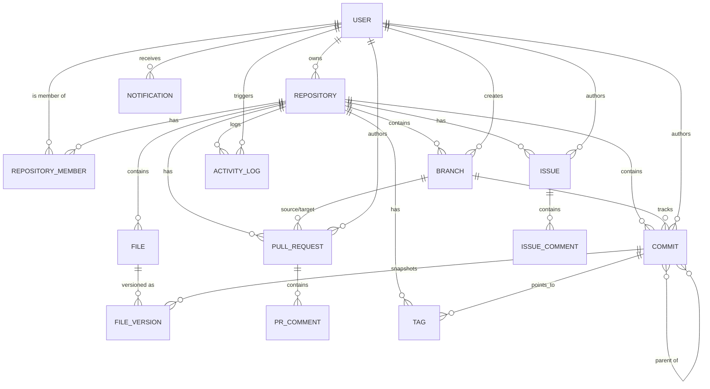

# Mímir Entity-Relationship Diagram

## Relationships
- **User (1) to (N) Repository:** A user can own multiple repositories.
- **Commit (N) to (M) Commit:** Commits form a Directed Acyclic Graph (DAG) through the `parentCommits` array.
- **Commit (1) to (N) FileVersion:** A commit acts as a snapshot for multiple file versions at a specific point in time.
